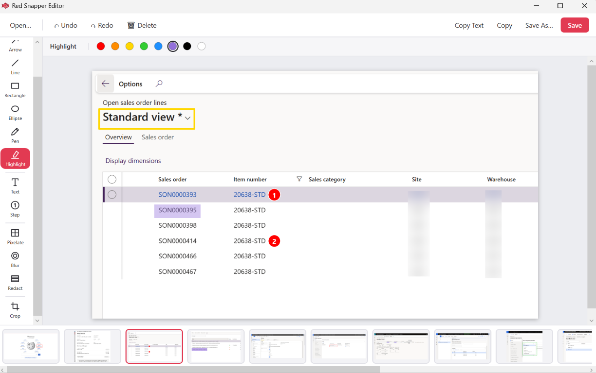

<p align="center">
  
</p>

<h1 align="center">Red Snapper</h1>

A Windows (WPF / .NET 8) screen capture and annotation tool, based on [Snappilot](https://github.com/shipiit/snappilot), the open-source
macOS screen capture and annotation tool (MIT licensed). This is a ground-up rewrite, since the original
relies on Apple-only frameworks (SwiftUI, ScreenCaptureKit, Vision).

## See it in action

<p align="center">
  
</p>

## Install and use (no technical skills needed)

⚠️ **REQUIRED: .NET 8 Desktop Runtime**

Red Snapper **requires** the **.NET 8 Desktop Runtime** to run. Install it first from: https://dotnet.microsoft.com/download/dotnet/8.0 (choose "Desktop Runtime" and your PC type, usually x64). If you skip this, Red Snapper won't start.

**What you need:** a Windows 10 or 11 PC with the **.NET 8 Desktop Runtime** already installed.

**Install**

1. Download [`RedSnapper.zip`](installer/Output/RedSnapper.zip) from this repository.
2. Right-click it, choose **Extract All**, and open the extracted `RedSnapper` folder.
3. Double-click **Install.cmd**. Answer the two questions (press Enter to accept the first one, which makes Red
   Snapper start when you sign in). The little red fish appears in the system tray when it's ready.

To update, extract the new zip and run **Install.cmd** again. To remove it, run **Uninstall.cmd**.

(`RedSnapper-Setup.exe` is also available for PCs that allow unsigned installers, but most company laptops
block it, so use the zip.)

**Take a screenshot**

1. Look for the little red fish in the system tray (bottom-right of the screen, near the clock; you may need to
   click the ^ arrow). That means Red Snapper is running. If it isn't, open it from the Start menu.
2. Press **Print Screen** (**PrtScn**). The screen freezes and dims.
3. Either **click a window** to capture just that window, or **drag** a box around the part you want.
   Press **Esc** to cancel.
4. Your screenshot opens in the editor. Use the tools on the left to add arrows, boxes, text, blur, and more.
5. Click **Copy** to paste it into an email or chat, or **Save** to keep it as a file (saved to
   `Pictures\Red Snapper` unless you change it in Settings).

Every screenshot is kept in the strip along the bottom of the editor, so you can click back to an earlier one.
To remove one, click its thumbnail and press **Delete**. To remove several, hold **Ctrl** and click each one (or **Shift** and click to select a range), then press **Delete**.
Press **Ctrl+Shift+H** (or right-click the fish and choose **History**) to browse and search old screenshots,
including by the words inside them.

**Handy shortcuts**

| Press | To |
|---|---|
| Print Screen or Ctrl+Shift+S | Capture a window or region |
| Ctrl+Shift+F | Capture the whole screen |
| Ctrl+Shift+H | Open History |
| Ctrl+C | Copy the screenshot |
| Ctrl+Z / Ctrl+Y | Undo / redo |

Right-click the fish in the tray for **Settings**, where you can change these keys, choose the save folder, and
turn "Start with Windows" on or off. To remove Red Snapper, run **Uninstall.cmd** from the zip.

## Troubleshooting

- **Print Screen opens the Windows Snipping Tool instead.** Right-click the fish, choose **Settings**, and tick
  **"Let Red Snapper use Print Screen"**. Or use **Ctrl+Shift+S** instead.
- **Nothing happens when I double-click it.** It may already be running: look for the fish in the tray.
- **"Access is denied" or "blocked by your IT administrator".** Your company blocks unsigned apps. Ask IT to
  allow Red Snapper, or ask them how to share internal tools.
- **"You must install .NET" or the app won't start.** Install the *.NET 8 Desktop Runtime* (x64) from
  <https://dotnet.microsoft.com/download/dotnet/8.0>, or ask IT.

## Features

- Runs in the system tray with global hotkeys (see above; all can be changed in Settings)
- Region selector over a frozen screenshot; click a window to capture just that window (Esc / right-click cancels)
- One editor window with a filmstrip of your recent captures
- Every capture is saved to a history library (`%LOCALAPPDATA%\Red Snapper\History`) and its text is read with
  Windows OCR, so you can search inside past screenshots from the History window
- Annotations are saved with each capture and stay editable: reopen it from History to move, change or delete
  them. The original image is never modified; Copy/Save export a flattened copy
- Annotation editor: select/move/resize, arrow (several head styles), line, rectangle, ellipse, pen, highlight,
  text, numbered steps, pixelate, blur, solid redact, and crop. Color and width controls. Undo/redo, Delete.
- Copy to clipboard (Ctrl+C), Save (Ctrl+S), Save As (PNG/JPEG/BMP), and a "Copy Text" button (OCR)
- Open existing images (file picker or command-line argument)
- Zoom with Ctrl+mouse wheel or the zoom bar

## Not yet ported

Screen recording, scroll capture, tasks/meeting notes, GIF export.

## For developers

**Run from source** (requires the [.NET 8 SDK](https://dotnet.microsoft.com/download/dotnet/8.0)):

```
dotnet run
```

**Build the installer** (requires [Inno Setup 6](https://jrsoftware.org/isinfo.php), e.g. `winget install JRSoftware.InnoSetup`):

```
powershell -ExecutionPolicy Bypass -File installer\build.ps1
```

The result is `installer\Output\RedSnapper-Setup.exe`. The app is launched through `dotnet.exe RedSnapper.dll`
because some company security policies block the unsigned `RedSnapper.exe`.

**Build the zip package** (no extra tools; this is the one to share on locked-down PCs):

```
powershell -ExecutionPolicy Bypass -File installer\build-zip.ps1
```

The result is `installer\Output\RedSnapper.zip`.

## Known limitations

- Region capture on multi-monitor setups with different DPI scaling is untested.
- Pixelate is applied to the base screenshot, not to other annotations beneath it.

## License

MIT, matching the original project. See the upstream repository for its copyright notice.
