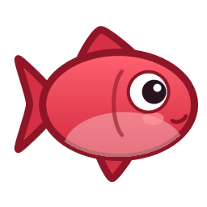

<p align="center">
  
</p>

<h1 align="center">Red Snapper</h1>

A Windows (WPF / .NET 8) screen capture and annotation tool, based on [Snappilot](https://github.com/shipiit/snappilot), the open-source
macOS screen capture and annotation tool (MIT licensed). This is a ground-up rewrite, since the original
relies on Apple-only frameworks (SwiftUI, ScreenCaptureKit, Vision).

## Features (MVP)

- Runs in the system tray. Global hotkeys:
  - **Print Screen** or **Ctrl+Shift+S**: capture a region
  - **Ctrl+Shift+F**: capture all screens
  - **Ctrl+Shift+H**: open History
- Region selector over a frozen screenshot (Esc / right-click cancels)
- Every capture is saved to a history library (`%LOCALAPPDATA%\Red Snapper\History`) and its text is read with
  Windows OCR, so you can search inside past screenshots from the History window
- Annotations are saved with each capture and stay editable: reopen it from History to move, change or delete
  them. The original image is never modified; Copy/Save export a flattened copy
- "Start with Windows" toggle in the tray menu
- **Settings** (tray menu): change or disable any hotkey and choose the default save folder. Defaults are the keys above.
- Annotation editor: select/move, arrow, line, rectangle, ellipse, highlight, text, numbered steps,
  pixelate, solid redact. Color and width controls. Undo/redo (Ctrl+Z / Ctrl+Y), Delete.
- Copy to clipboard (Ctrl+C), Save (Ctrl+S, to `Pictures\Red Snapper`), Save As (PNG/JPEG/BMP)
- Open existing images (File picker or command-line argument)
- Ctrl+mouse wheel to zoom

## Not yet ported

Screen recording, scroll capture, tasks/meeting notes, GIF export.

## Build and run

Requires the [.NET 8 SDK](https://dotnet.microsoft.com/download/dotnet/8.0).

```
dotnet run
```

## Known limitations

- Region capture on multi-monitor setups with different DPI scaling is untested.
- Pixelate is applied to the base screenshot, not to other annotations beneath it.

## License

MIT, matching the original project. See the upstream repository for its copyright notice.
